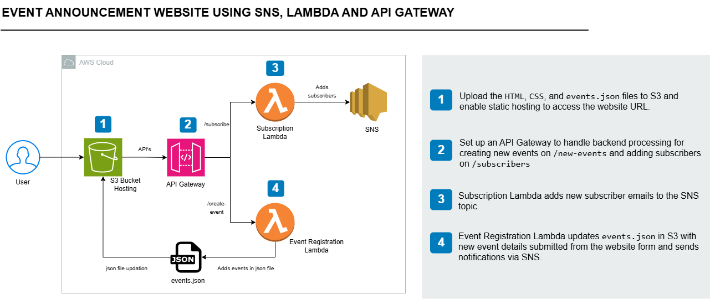
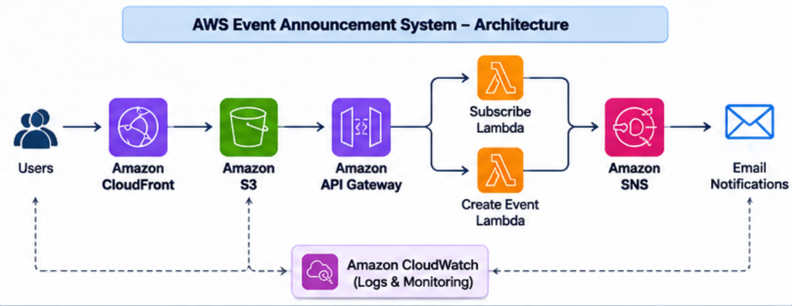
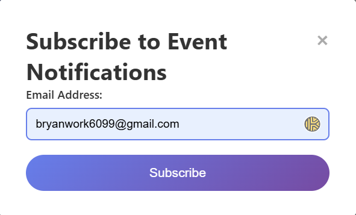
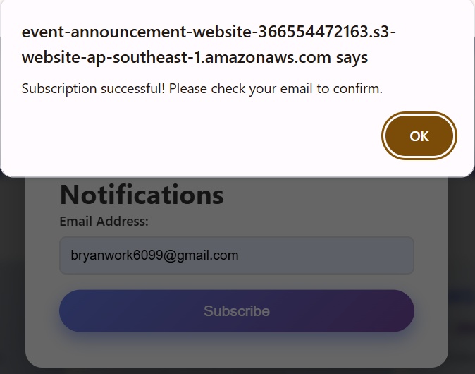
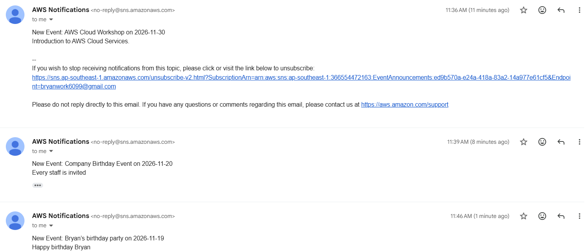
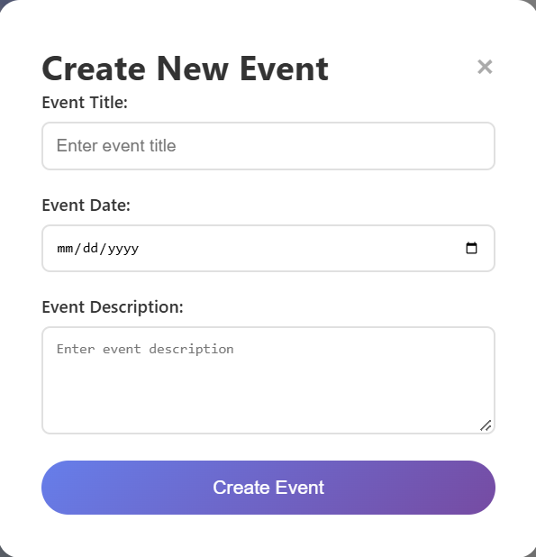
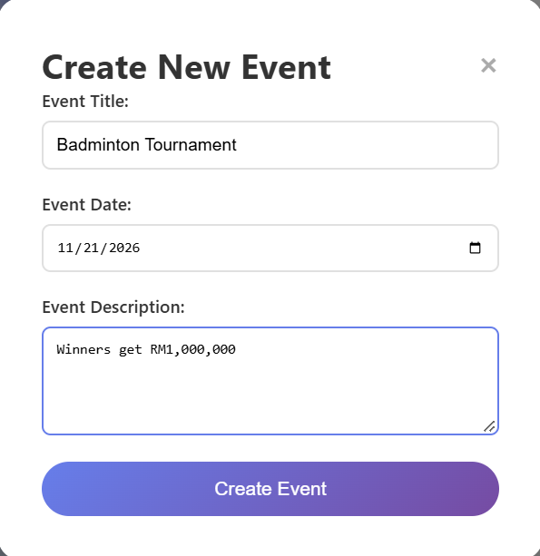
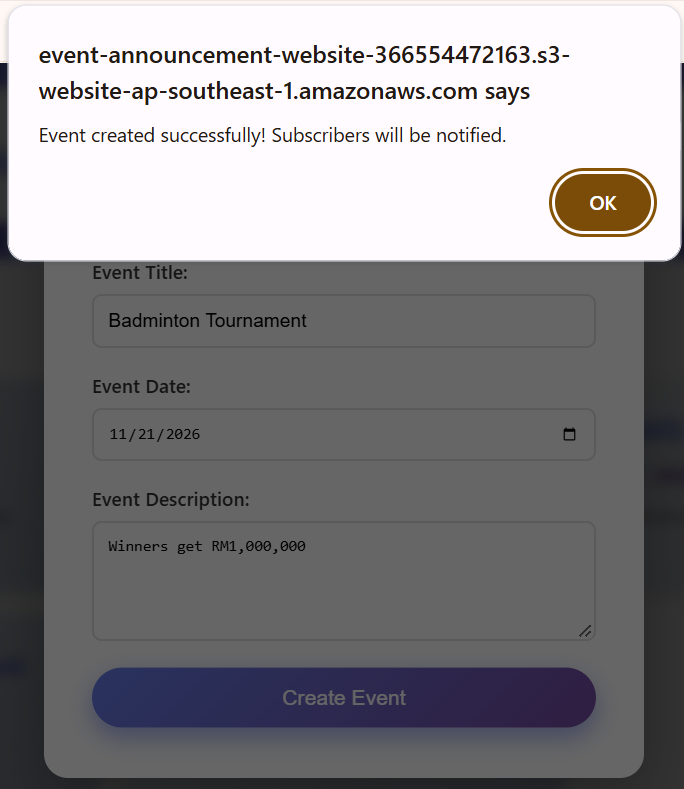
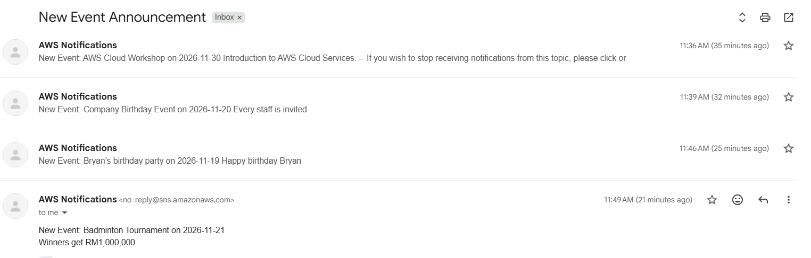
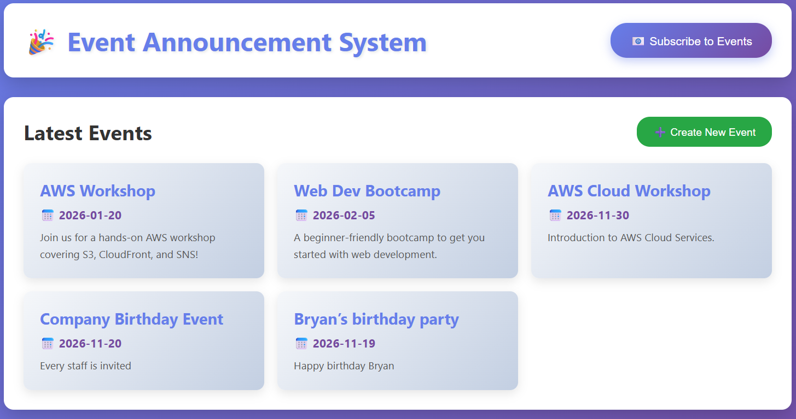

# AWS Event Announcement System
## Deployment, Configuration, Testing and Troubleshooting Guide

**Project Name:** AWS Event Announcement System  
**Cloud Provider:** Amazon Web Services (AWS)  
**Infrastructure as Code:** Terraform  
**Deployment Region:** Asia Pacific (Singapore) – ap-southeast-1  
**Frontend:** HTML, CSS and JavaScript  
**Architecture:** Serverless, Event-Driven Application

---

# 1. Project Overview

The AWS Event Announcement System is a serverless web application that allows users to subscribe to event notifications through an email address.

The application also provides an interface for administrators or users to create new events. Once a new event is created, the application stores the event information in Amazon S3 and publishes an announcement through Amazon Simple Notification Service (SNS).

Subscribers who have confirmed their email addresses receive event announcement notifications automatically.

The infrastructure is deployed using Terraform to automate the provisioning and configuration of AWS resources.

## 1.1 Project Objectives

- Build a serverless event announcement application using AWS.
- Implement email subscriptions using Amazon SNS.
- Use AWS Lambda to process subscription and event creation requests.
- Expose backend functionality through Amazon API Gateway.
- Host the frontend using Amazon S3 and Amazon CloudFront.
- Automate infrastructure deployment using Terraform.
- Demonstrate integration between multiple AWS services.

# 2. AWS Services Used

| AWS Service | Purpose |
|---|---|
| Amazon S3 | Stores website files and event data |
| Amazon CloudFront | Distributes website content |
| Amazon API Gateway | Exposes backend REST API endpoints |
| AWS Lambda | Processes subscriptions and event creation |
| Amazon SNS | Manages email subscriptions and sends notifications |
| AWS IAM | Controls permissions for Lambda execution |
| Amazon CloudWatch | Stores Lambda execution logs and monitoring information |

## 2.1 Application Architecture

The application consists of two main workflows.

**A. Email Subscription Workflow**

1. A user opens the website.
2. The user enters an email address.
3. The frontend sends a POST request to API Gateway.
4. API Gateway invokes the Subscribe Lambda function.
5. Lambda requests an email subscription through Amazon SNS.
6. SNS sends a confirmation email to the user.
7. The user confirms the subscription through the email link.

**B. Event Announcement Workflow**

1. A user creates a new event through the website.
2. The frontend sends event details to API Gateway.
3. API Gateway invokes the Create Event Lambda function.
4. Lambda stores the event information in Amazon S3.
5. Lambda publishes an announcement to Amazon SNS.
6. SNS distributes the notification to confirmed subscribers.

### 2.1.1 Network Architecture Flow Diagram

The flow diagram illustrates how users interact with the application, from accessing the website and subscribing to email notifications to creating events and receiving announcements.



### 2.1.2 Network Architecture Topology Diagram

The topology diagram provides a visual representation of the AWS infrastructure and how the services are interconnected, including Amazon S3, CloudFront, API Gateway, Lambda, SNS, IAM, and CloudWatch.



# 3. Project Folder Structure

The project uses the following folder structure:

```text
Event-Announcement-System/
│
├── terraform/
│   ├── main.tf
│   ├── variables.tf
│   ├── outputs.tf
│   └── terraform.tfvars
│
├── lambda/
│   ├── subscribe.py
│   └── create_event.py
│
├── frontend/
│   ├── index.html
│   ├── styles.css
│   └── events.json
│
├── scripts/
│   └── update-frontend.sh
│
├── deploy.sh
|
├── destroy.sh
|
├── .gitignore
|
└── README.md
```

### Folder descriptions

- **terraform/** – Contains Terraform configuration files used to provision AWS resources.
- **lambda/** – Contains Python source code for the Lambda functions.
- **frontend/** – Contains the website's HTML, CSS and event data.
- **scripts/** – Contains scripts for frontend deployment and updates.
- **deploy.sh** – Contains the project's deployment automation script.
- **README.md** – Provides project information and setup instructions.

# 4. Prerequisites and Initial Setup

Before deploying the project, install the following tools.

## 4.1 Required Software

| Software | Purpose |
|---|---|
| AWS CLI | Connects to and manages AWS resources |
| Terraform | Provisions AWS infrastructure |
| Git | Clones and manages the project repository |
| Python | Supports Lambda development and related scripts |
| Visual Studio Code | Edits project configuration and source files |
| Web Browser | Accesses and tests the application |

Ensure that the commands are accessible from PowerShell.

Verify the installations:

```powershell
aws --version
terraform --version
git --version
python --version
```

## 4.2 Clone the GitHub Repository

Clone the project:

```powershell
git clone https://github.com/yeshwanthlm/Event-Announcement-System-using-SNS-Lambda-and-API-Gateway.git
```

Navigate into the project:

```powershell
cd Event-Announcement-System-using-SNS-Lambda-and-API-Gateway
```

Open the project using Visual Studio Code:

```powershell
code .
```

## 4.3 Configure AWS CLI

Configure AWS credentials:

```powershell
aws configure
```

Provide the following information when prompted:

- AWS Access Key ID
- AWS Secret Access Key
- Default region name: `ap-southeast-1`
- Default output format: `json`

**Important:** Never publish AWS access keys or secret keys in GitHub repositories or project documentation.

Verify the AWS CLI configuration:

```powershell
aws configure list
```

Verify AWS authentication:

```powershell
aws sts get-caller-identity
```

A successful response confirms that the AWS CLI can authenticate with the configured AWS account.

# 5. Terraform Configuration

Terraform is used to provision the AWS infrastructure.

The Terraform configuration is maintained inside the `terraform` directory.

Navigate to the directory:

```powershell
cd terraform
```

## 5.1 Configure variables.tf

The `variables.tf` file defines the configurable values used by Terraform.

Example configuration:

```hcl
variable "aws_region" {
  description = "AWS region for resources"
  type        = string
  default     = "ap-southeast-1"
}

variable "bucket_name" {
  description = "S3 bucket name for website hosting"
  type        = string
}

variable "cloudfront_price_class" {
  description = "CloudFront price class"
  type        = string
  default     = "PriceClass_100"
}
```

## 5.2 Configure terraform.tfvars

The `terraform.tfvars` file provides the actual values for the Terraform variables.

Example:

```hcl
aws_region  = "ap-southeast-1"
bucket_name = "event-announcement-website-366554472163"
```

The S3 bucket name must be globally unique.

**Security note:** Keep `terraform.tfvars` out of Git because configuration files may contain sensitive values.

## 5.3 Initialize Terraform

Run:

```powershell
terraform init
```

This downloads the required Terraform providers and initializes the working directory.

## 5.4 Format Terraform Files

Run:

```powershell
terraform fmt
```

This standardizes the formatting of the Terraform configuration files.

## 5.5 Validate the Configuration

Run:

```powershell
terraform validate
```

A successful validation confirms that the Terraform configuration is syntactically valid.

## 5.6 Review the Deployment Plan

Run:

```powershell
terraform plan
```

Review the resources Terraform intends to create, modify or destroy.

Check that the resources are configured for the intended AWS region and that no unexpected destructive changes are planned.

## 5.7 Deploy AWS Infrastructure

After reviewing the plan:

```powershell
terraform apply
```

Terraform displays the planned changes and asks for confirmation.

Enter:

```text
yes
```

Terraform will provision the configured AWS resources.

Wait for the deployment to complete successfully.

## 5.8 Retrieve Terraform Outputs

Run:

```powershell
terraform output
```

The command displays important deployment information, including:

- API Gateway base URL
- Subscription endpoint
- Event creation endpoint
- CloudFront distribution ID
- CloudFront domain
- CloudFront website URL
- S3 bucket name
- SNS topic ARN
- S3 website URL

These outputs are useful when configuring the frontend and verifying the deployment.

# 6. Frontend Configuration

After deploying the AWS infrastructure, update the frontend configuration to use the actual API Gateway endpoint.

## 6.1 Locate index.html

Open:

```text
frontend/index.html
```

Find the API Gateway configuration inside the JavaScript section.

Example:

```javascript
const API_BASE_URL = 'YOUR_API_GATEWAY_URL';

const SUBSCRIBE_ENDPOINT =
    `${API_BASE_URL}/subscribe`;

const CREATE_EVENT_ENDPOINT =
    `${API_BASE_URL}/create-event`;
```

Replace the placeholder with the actual API Gateway base URL returned by Terraform.

For this deployment:

```javascript
const API_BASE_URL =
    'https://xrn9lg7hzg.execute-api.ap-southeast-1.amazonaws.com/dev';

const SUBSCRIBE_ENDPOINT =
    `${API_BASE_URL}/subscribe`;

const CREATE_EVENT_ENDPOINT =
    `${API_BASE_URL}/create-event`;
```

**Important:** Always use the API Gateway URL returned by the current Terraform deployment.

The API region must match the region in which the API Gateway was deployed.

## 6.2 Upload the Updated Frontend to S3

Updating the local HTML file does not automatically update the website hosted in S3.

Navigate to the project root:

```powershell
cd ..
```

Upload the updated HTML file:

```powershell
aws s3 cp .\frontend\index.html s3://event-announcement-website-366554472163/index.html --content-type "text/html"
```

The upload replaces the existing S3 object with the same key.

The website can then serve the updated HTML file.

If other frontend files are changed, upload those files as well.

For example:

```powershell
aws s3 cp .\frontend\styles.css s3://event-announcement-website-366554472163/styles.css --content-type "text/css"

aws s3 cp .\frontend\events.json s3://event-announcement-website-366554472163/events.json --content-type "application/json"
```

## 6.3 Access the Website

Use the CloudFront URL provided by Terraform:

```text
https://d2a0y3c586m91l.cloudfront.net
```

Alternatively, the S3 static website endpoint is available through the `website_url` Terraform output.

CloudFront is recommended for accessing the website over HTTPS.

If the website was updated but an old version is still displayed, perform a hard refresh using:

```text
Ctrl + Shift + R
```

# 7. Email Subscription Setup and Testing

After the website is deployed, test the subscription workflow.

## 7.1 Open the Website

Navigate to the CloudFront website URL.

Click:

**Subscribe to Events**

Enter a valid email address and submit the form.

## 7.2 Confirm the Email Subscription

Open the email inbox associated with the submitted address.

Look for an Amazon SNS subscription confirmation email.

Open the email and click:

**Confirm subscription**

The confirmation process activates the email subscription.

Until the email address is confirmed, it will not receive normal SNS topic notifications.

## 7.3 Verify the Subscription

Open the Amazon SNS console.

Navigate to:

1. Topics
2. EventAnnouncements
3. Subscriptions

Check that the email subscription is listed with a confirmed status.

# 8. Event Creation and Notification Testing

Once the email subscription is confirmed, test the event announcement workflow.

## 8.1 Create a Test Event

Open the website and click:

**Create New Event**

Enter the following sample information:

- Event Title: AWS Cloud Workshop
- Event Date: Choose a future date.
- Event Description: Introduction to AWS Cloud Services.

Click **Create Event**.

## 8.2 Verify Event Creation

Check that the application displays a successful event creation message.

The Create Event Lambda function should process the request, store the event information in S3 and publish an announcement through SNS.

## 8.3 Verify Email Notification

Open the confirmed subscriber's email inbox.

Check whether an event announcement email has arrived.

Successful receipt confirms that the event creation and notification workflow is functioning.

# 9. Monitoring and Troubleshooting

AWS CloudWatch can be used to monitor Lambda execution and troubleshoot backend errors.

## 9.1 Lambda CloudWatch Logs

Open the AWS Lambda console and select the relevant function.

Navigate to:

**Monitor → View CloudWatch logs**

The log groups normally follow this naming convention:

```text
/aws/lambda/SubscribeToSNSFunction
/aws/lambda/CreateEventFunction
```

Check the latest log streams for execution errors.

Note that CloudWatch log groups may not exist until the function is invoked and attempts to write logs.

The Lambda execution role needs appropriate CloudWatch logging permissions, such as `AWSLambdaBasicExecutionRole`.

## 9.2 Issue: Email Subscription Does Not Work

**Symptom:** The user submits an email address but does not receive a subscription confirmation email.

**Troubleshooting:**

1. Verify that the website uses the correct API Gateway endpoint.
2. Check the browser Developer Tools.
3. Open the Network tab.
4. Submit the subscription form again.
5. Inspect the request URL, HTTP method and status.
6. Check Lambda invocation metrics.
7. Review CloudWatch logs.
8. Verify the SNS topic and email subscription.

## 9.3 Issue: Incorrect API Gateway Region

During deployment testing, the frontend was found to be using an old API Gateway URL in the `us-east-1` region.

However, the actual API Gateway deployment was in Singapore:

```text
ap-southeast-1
```

The incorrect endpoint prevented the browser from reaching the intended API.

**Resolution:**

Retrieve the correct endpoint:

```powershell
terraform output
```

Update the API URL in `frontend/index.html`.

Upload the corrected HTML file to S3:

```powershell
aws s3 cp .\frontend\index.html s3://event-announcement-website-366554472163/index.html --content-type "text/html"
```

Hard-refresh the website and test again.

## 9.4 Issue: CloudWatch Log Group Does Not Exist

**Possible causes:**

- The Lambda function has not been invoked yet.
- The wrong AWS region or function name is being checked.
- The Lambda execution role cannot create or write CloudWatch logs.

**Resolution:**

- Confirm the Lambda function name.
- Confirm the AWS region.
- Verify the execution role includes `AWSLambdaBasicExecutionRole`.
- Trigger the Lambda function and check the logs again.

## 9.5 Useful Troubleshooting Commands

Check AWS identity:

```powershell
aws sts get-caller-identity
```

Check AWS CLI configuration:

```powershell
aws configure list
```

Check Terraform outputs:

```powershell
terraform output
```

Check Terraform configuration:

```powershell
terraform validate
```

Review infrastructure changes:

```powershell
terraform plan
```

# 10. Security and Operational Considerations

The current deployment is designed as a demonstration project. Several configurations should be reviewed before using the application in a production environment.

## 10.1 Public S3 Website Access

The current architecture uses S3 static website hosting with public read access to website objects.

This is required by the selected public S3 website hosting design.

Do not store passwords, access keys, private documents or sensitive information in this public website bucket.

## 10.2 API Gateway Authorization

The current `/subscribe` and `/create-event` POST endpoints use no authorization.

This makes the demonstration easier to test, but anyone who discovers the endpoints may be able to submit requests.

For production, consider authentication and authorization, request validation, rate limiting and abuse protection.

## 10.3 IAM Permissions

The current Lambda execution roles use broad managed policies, including:

- AmazonSNSFullAccess
- AmazonS3FullAccess
- AWSLambdaBasicExecutionRole

For production, replace broad permissions with least-privilege IAM policies that allow only the specific actions and resources required by each function.

## 10.4 AWS Costs

Some AWS services may incur charges depending on usage.

Monitor the following services:

- Amazon CloudFront
- Amazon S3
- Amazon API Gateway
- AWS Lambda
- Amazon SNS
- Amazon CloudWatch

Review AWS Billing and Cost Management regularly.

# 11. Updating and Maintaining the Application

When making changes to the project, distinguish between infrastructure changes and frontend changes.

**Frontend-only changes**

Examples:
- Updating website text.
- Changing website styles.
- Modifying the event display.

Upload the modified frontend files to S3.

**Infrastructure changes**

Examples:
- Changing Lambda configuration.
- Adding new AWS resources.
- Modifying API Gateway settings.
- Changing IAM permissions.

Update the Terraform configuration and review the deployment plan before applying changes.

Recommended Terraform workflow:

```powershell
terraform fmt
terraform validate
terraform plan
terraform apply
```

Do not run `terraform apply` without reviewing the proposed changes.

# 12. Deployment Results

This section highlights the successful deployment and end-to-end testing of the AWS Event Announcement System. The screenshots demonstrate the email subscription process, event creation workflow, real-time notifications, and final website interface.

## 12.1 Email Subscription Request

A user enters their Gmail address through the website to subscribe to event announcements.



## 12.2 Successful Email Subscription

The website displays a success notification after the subscription request has been processed successfully.



## 12.3 Subscription Confirmation Email

Gmail displays the Amazon SNS subscription confirmation email, allowing the user to confirm their subscription.



## 12.4 Create New Event Interface

The event creation form allows users to enter the event title, date, and description.



## 12.5 Real-Time Event Creation

An example of creating a new event through the website using the event submission form.



## 12.6 Successful Event Creation

The website displays a confirmation message after the new event has been successfully created and processed.



## 12.7 Real-Time Event Announcement Email

Gmail receives the newly created event announcement through Amazon SNS, demonstrating successful notification delivery to confirmed subscribers.



## 12.8 Completed Website Interface

The final website layout displaying the AWS Event Announcement System and its event management functionality.



# 13. Conclusion

The AWS Event Announcement System demonstrates how multiple AWS services can be integrated to build a serverless, event-driven application.

By combining Amazon S3, CloudFront, API Gateway, Lambda, SNS, IAM and CloudWatch, the project provides a practical example of serverless application deployment and automated event notifications.

Terraform simplifies infrastructure provisioning and makes the deployment process repeatable.

The completed project demonstrates practical experience with:

- Infrastructure as Code.
- Serverless application architecture.
- AWS networking and API integration.
- Event-driven application design.
- Email notification workflows.
- IAM permissions and access management.
- CloudWatch monitoring and troubleshooting.
- AWS resource deployment and maintenance.

**End of Documentation**
